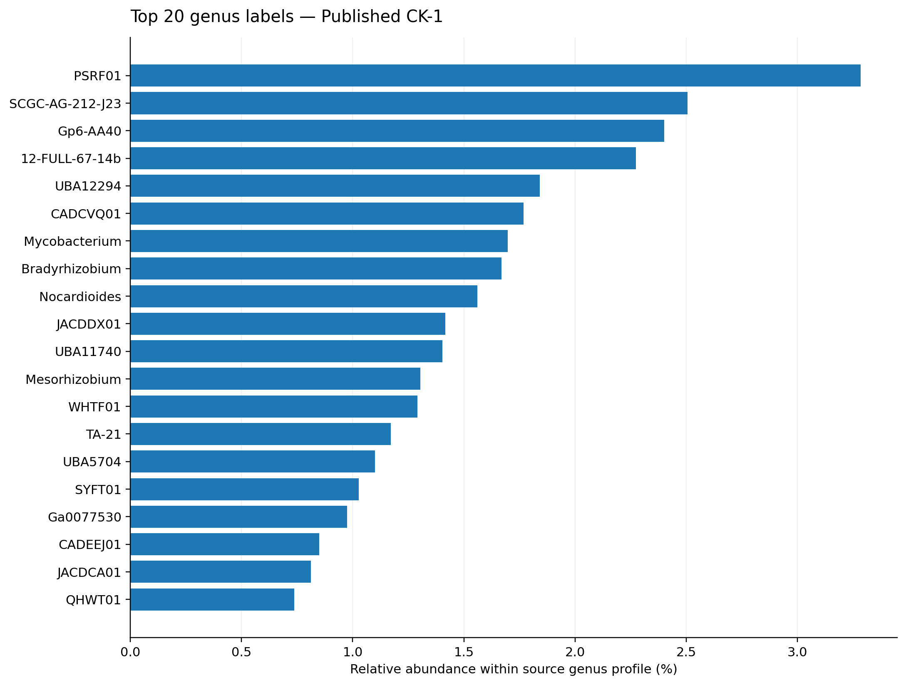
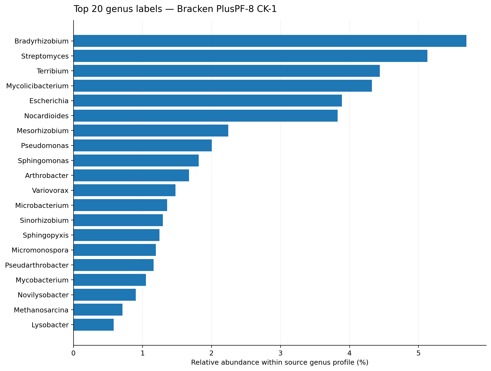
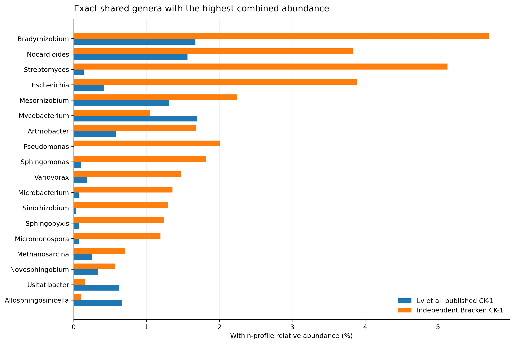
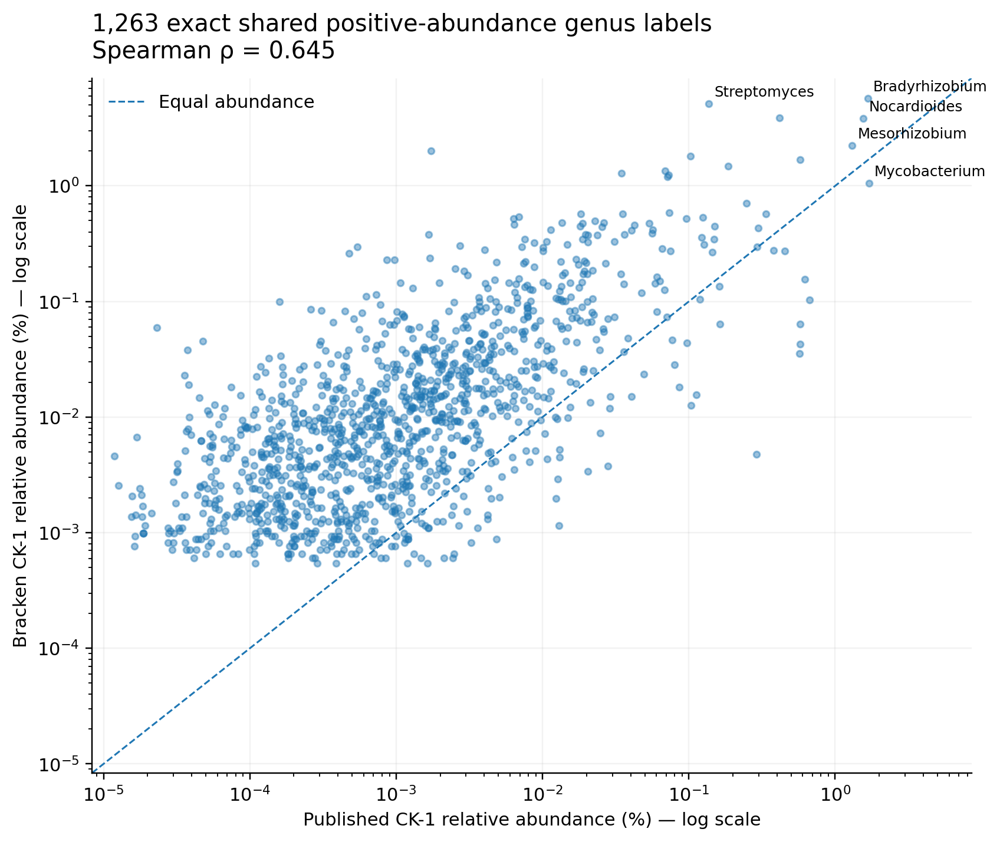
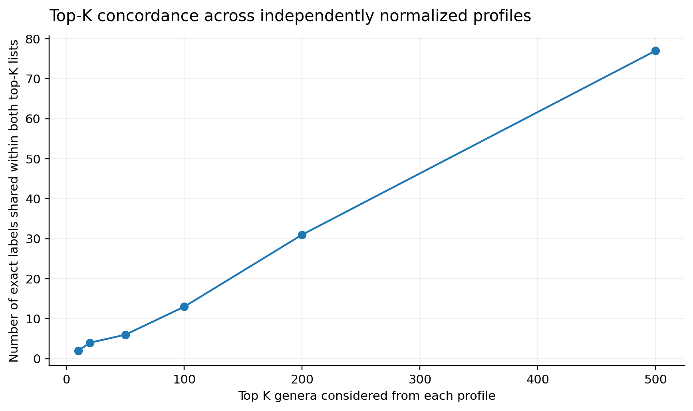

# CK-1 genus-profile comparison: Lv et al. (2026) versus Kraken2–Bracken PlusPF-8

**Study:** Lv et al. (2026), *Frontiers in Plant Science*, DOI: 10.3389/fpls.2026.1753229 
**Sample:** CK-1 (`SRR36739085`), the same biological sample in both datasets 
**Status:** Completed exploratory single-sample comparison; not a treatment-level replication.

## Sources and method

1. **Published:** `table 4.xlsx`, `Sheet1`, header `genus`, first numeric column (`1`) confirmed to represent CK-1 against the published `data sheet 2.csv` percentages. Contains 15,805 named genus-level labels. The published numerical unit is undocumented; original values were preserved and normalized by the CK-1 column sum (954,879.479053 original units).
2. **Independent:** `CK1_pluspf8_c0_genus.bracken`, Bioconda Bracken package 3.1 (whose bundled executable reports v3.0.1; `-l G -r 150 -t 10`), using Kraken2 2.17.2 and the MD5-verified 26 June 2026 PlusPF-8 reference. Normalization for quantitative comparisons uses `new_est_reads / sum(new_est_reads)` (1,829,204 row-summed estimated fragments). Bracken's reported `fraction_total_reads` is also retained unchanged in the full CSV; the two representations differ slightly because abundance is calculated as floating point and exported as integer counts.
3. **Matching:** Exact, case-sensitive genus-label equality. No inference of taxonomic synonymy or equivalence for names from different taxonomic frameworks. Absence of a label in a source is marked as *not listed*, **not** as a confirmed biological zero.
4. **Statistics:** Descriptive genus-level comparison within **one sample**: Spearman rank correlation over labels with positive abundance in both sources, log10-scale Pearson correlation, top-K exact-label intersections, and Bray–Curtis/Jensen–Shannon between normalized vectors on the exact-label union. The distances are database-/nomenclature-dependent *profile differences*, not ecological between-sample diversity or treatment effect.

Twelve label cells in the published workbook were stored as Excel date-formatted numbers. The extracted input preserves their underlying serial values because their intended original genus strings cannot be recovered. None matches a Bracken genus; substituting the ISO date strings used in the processed repository table leaves all reported numerical metrics unchanged.

## Quantitative findings

| Measure | Value |
|---|---:|
| Labels in published genus matrix | 15,805 |
| Positive published CK-1 genus labels | 13,333 |
| Genera in Bracken output | 1,897 |
| Labels exactly shared across both tables | 1,358 |
| Shared labels with positive abundance in both | 1,263 |
| Bracken genera absent as exact labels from published table | 539 |
| Positive published CK-1 labels absent as exact labels from Bracken | 12,070 |
| Bracken abundance represented by exactly shared labels | 82.23% |
| Published abundance represented by exactly shared labels | 19.74% |
| Spearman ρ (shared positive, n=1,263) | 0.645 |
| Pearson r of log10 proportional abundances (same subset) | 0.681 |
| Intersection of the two top-10 lists | 2/10 |
| Intersection of the two top-20 lists | 4/20 |
| Bray–Curtis on exact-label union | 0.849 |
| Jensen–Shannon divergence (base 2) on exact-label union | 0.741 |

### Published CK-1 dominant labels

| Published rank | Genus label | Published CK-1 (%) | Bracken CK-1 (%) |
|---:|---|---:|---|
| 1 | PSRF01 | 3.285 | not listed |
| 2 | SCGC-AG-212-J23 | 2.506 | not listed |
| 3 | Gp6-AA40 | 2.402 | not listed |
| 4 | 12-FULL-67-14b | 2.273 | not listed |
| 5 | UBA12294 | 1.842 | not listed |
| 6 | CADCVQ01 | 1.769 | not listed |
| 7 | Mycobacterium | 1.698 | 1.048 |
| 8 | Bradyrhizobium | 1.670 | 5.696 |
| 9 | Nocardioides | 1.560 | 3.828 |
| 10 | JACDDX01 | 1.417 | not listed |

### Reconstructed CK-1 dominant genera

| Bracken rank | Genus | Bracken CK-1 (%) | Published CK-1 (%) |
|---:|---|---:|---|
| 1 | Bradyrhizobium | 5.696 | 1.670 |
| 2 | Streptomyces | 5.131 | 0.137 |
| 3 | Terribium | 4.440 | not listed |
| 4 | Mycolicibacterium | 4.325 | not listed |
| 5 | Escherichia | 3.889 | 0.416 |
| 6 | Nocardioides | 3.828 | 1.560 |
| 7 | Mesorhizobium | 2.242 | 1.305 |
| 8 | Pseudomonas | 2.005 | 0.002 |
| 9 | Sphingomonas | 1.814 | 0.103 |
| 10 | Arthrobacter | 1.675 | 0.576 |

## Interpretation

The independent reconstruction recovers a coherent set of soil-associated genera, including *Bradyrhizobium*, *Mesorhizobium*, *Streptomyces*, *Nocardioides*, *Sphingomonas* and *Arthrobacter*. Of 1,358 exactly shared genus labels, 1,263 have positive abundance in both sources, and those shared positive labels show a moderately strong positive abundance-rank association (Spearman ρ=0.645). Both top-10 lists include *Bradyrhizobium* and *Nocardioides*.

Nevertheless, **dominance and rank agreement are limited**: only 2 genera occur in both top-10 sets, and only 4 occur in both top-20 sets. Published CK-1 is led by several provisional labels (such as `PSRF01`, `SCGC-AG-212-J23` and `Gp6-AA40`) that have no exact-label counterpart in the PlusPF-8 Bracken output. Conversely, our reconstructed profile ranks *Streptomyces* and *Escherichia* much higher, and includes labels such as *Terribium* and *Mycolicibacterium* that are absent under those exact names in the published matrix. Distinct taxonomic naming frameworks and reference coverage likely contribute to this mismatch; an authoritative synonym/TaxID crosswalk would be needed to disentangle nomenclature from true assignment differences.

The independent Kraken2 step classified **1,833,747 / 33,808,912 non-host pairs (5.42%)** using the capped PlusPF-8 database. The known coverage limitation is described once here, rather than repeated throughout the biological interpretation. The attempt to use a larger, verified PlusPF-16 database was manually stopped for compute feasibility without producing a result; it cannot establish what PlusPF-16 would have classified. The authors' exact Kraken database build/size and percentage denominator are not stated, so disagreement is not evidence of an erroneous reconstruction, and the two genus profiles are not necessarily directly calibrated.

### One small Bracken accounting detail

The output contains `sum(new_est_reads) = 1,829,204`. The session's Bracken summary reports `1,830,146` genus-level reads before the final exported integer counts are aggregated, a difference of 942 fragments (~0.051%). Inspection of the installed Bracken abundance-estimation code confirms that redistributed abundance is calculated as floating point and each row is converted to an integer when written. Comparisons here renormalize those exported integer counts; `fraction_total_reads` is preserved verbatim alongside them for auditing.

## Figures

## Reuse and reporting boundaries

- These are **single-sample**, profile-to-profile descriptive results. They do not support CK versus LS/MS significance tests.
- Unmatched names should be called **label differences**, not taxa proven absent in the other sample/profile.
- The abundance denominator and incomplete Kraken classification must appear in methods and limitations, but the Results section can straightforwardly discuss recovered taxa and shared ecological signals.
- Follow-up: inspect taxonomic synonyms and classification evidence for striking mismatches; potentially compare against a better-resourced reference on HPC.
- For the eventual Snakemake workflow, use the validated sample manifest, database paths/versions, independent source-matrix branch, and exact-label comparison rule shown here.

## Generated files

- `comparison_metrics.json`: summary statistics and explicit denominators.
- `all_genus_exact_label_comparison.csv`: all 16,344 union labels, ranks, normalized proportions and matching status.
- `shared_positive_genera.csv`: positive-abundance exact-name matches.
- `top20_each_profile.csv`: both top-20 lists with counterparts if present.
- `compare_ck1_profiles.py`: reproducible comparison from the extracted published CK-1 column and the Bracken output.
