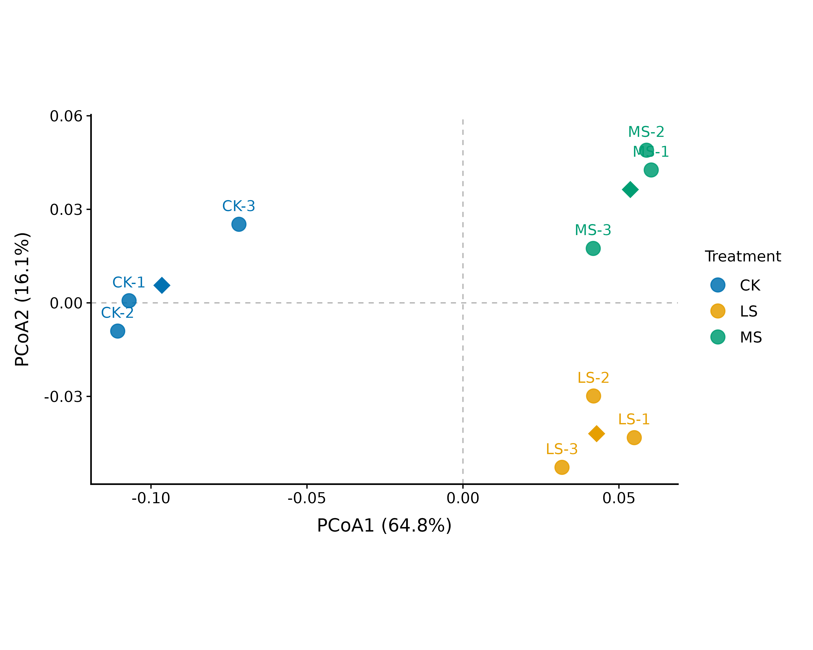
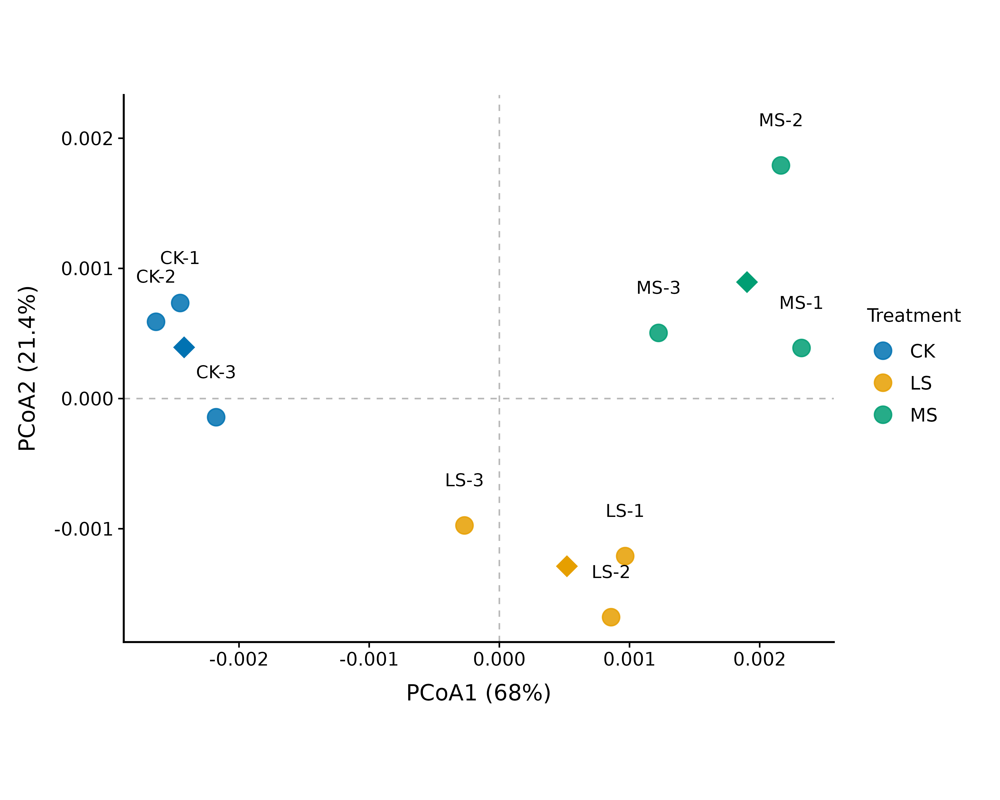

# Salinity-associated restructuring of the alfalfa root-zone microbiome

This repository independently reconstructs and reanalyses the public supplementary data from Lv et al. (2026), focusing on taxonomic restructuring, sample-level heterogeneity, functional-profile sensitivity, and reproducibility.

> **[View the full interactive report →](https://noureddineidali.github.io/alfalfa-salinity-metagenomics/)**

[BioProject PRJNA1399466](https://www.ncbi.nlm.nih.gov/bioproject/PRJNA1399466) · [Publication DOI](https://doi.org/10.3389/fpls.2026.1753229)

| Taxonomic restructuring | Functional restructuring | Functional diagnostic |
|:---:|:---:|:---:|
| **R² = 0.775** | **R² = 0.822** | **r = −0.9988** |
| genus-level Bray–Curtis PERMANOVA | normalized 30-pathway PERMANOVA | raw functional PCoA1 vs pathway total |

<table>
  <tr>
    <td width="50%" align="center">
      <br>
      <strong>Genus-level taxonomic community structure</strong><br>
      <sub>Bray–Curtis PCoA</sub>
    </td>
    <td width="50%" align="center">
      <br>
      <strong>Composition-normalized 30-pathway functional structure</strong><br>
      <sub>Bray–Curtis PCoA</sub>
    </td>
  </tr>
</table>

## What this reanalysis added

- **CK-3 sample-level diagnostic:** a conspicuous *Sediminibacterium* pattern led to the finding that CK-3 is displaced at the whole-community level while its measured soil profile remains CK-like.
- **Community effect quantified:** treatment explained 77.5% of genus-level Bray–Curtis variation, with no evidence from PERMDISP that unequal dispersion drove the result.
- **Functional sensitivity analysis:** raw functional PCoA1 almost perfectly tracked total selected-pathway abundance, but strong treatment structure remained after composition normalization (**R² = 0.822**).

## Study design

| Treatment | Applied salt | Sequenced samples |
|---|---:|---:|
| CK — control | 0 g kg⁻¹ | 3 |
| LS — low salinity | 3.0 g kg⁻¹ | 3 |
| MS — moderate salinity | 4.5 g kg⁻¹ | 3 |

The dataset contains nine shotgun metagenomes: three operationally defined root-zone soil samples per treatment.

## Workflow

```text
published supplementary data
→ reconstruction and validation
→ taxonomic composition / alpha diversity
→ Bray–Curtis / PCoA / PERMANOVA
→ environmental context
→ pathway analysis
→ functional sensitivity analysis
→ reproducibility audit
```

The completed reanalysis uses the released sample-level matrices. Independent raw-read processing is outside the present analytical layer.

## Reproducibility

The analysis uses R 4.3.3 with a synchronized [`renv.lock`](renv.lock) snapshot. Restore the package environment from the repository root:

```r
renv::restore()
```

The completed analyses are in [`analysis/`](analysis/), and the report source is in [`report/`](report/).

## Repository guide

| Path | Contents |
|---|---|
| [`analysis/`](analysis/) | Ordered R scripts for data inspection, diversity, community structure, environmental context, and functional profiles |
| [`data/metadata/`](data/metadata/) | Sample manifest and public accessions |
| [`data/processed/`](data/processed/) | Validated analysis-ready supplementary tables |
| [`results/figures/`](results/figures/) | Reanalysis figures |
| [`results/tables/`](results/tables/) | Diversity, ordination, environmental, and pathway results |
| [`report/`](report/) | [Rendered report](report/alfalfa_salinity_metagenome_reanalysis.html) and its [Quarto source](report/alfalfa_salinity_metagenome_reanalysis.qmd) |
| [`docs/`](docs/) | Public metadata, supplementary-data, validation, and nitrogen-mapping audits |
| [`scripts/`](scripts/) | Reproducible data-preparation and identifier-resolution utilities |

Detailed public documentation: [dataset reconnaissance](docs/dataset_reconnaissance.md) · [supplementary-data audit](docs/supplementary_data_audit.md) · [processed-data validation](docs/processed_data_validation.md) · [nitrogen mapping audit](docs/nitrogen_mapping_audit.md)

