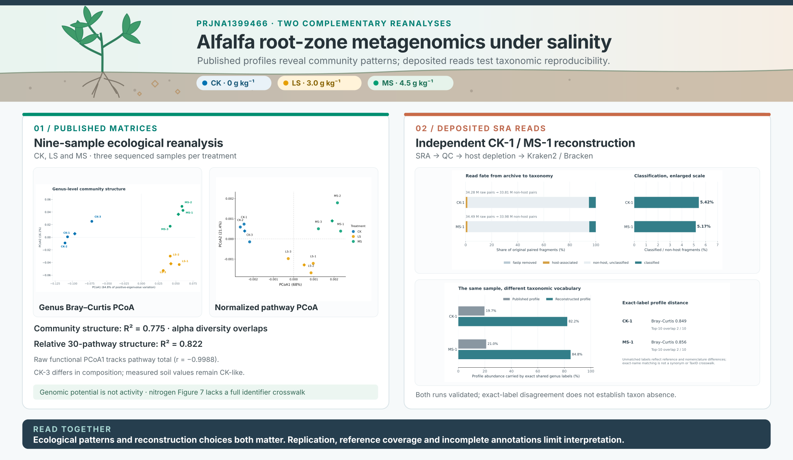

# Salinity-associated restructuring of the alfalfa root-zone microbiome

A reproducible reanalysis of the alfalfa root-zone shotgun metagenomics dataset published by Lv et al. (2026), combining ecological patterns across **nine samples** with independent raw-read reconstruction of **CK-1 and MS-1**.

**[Explore the project website →](https://noureddineidali.github.io/alfalfa-salinity-metagenomics/)**

**Research reports:** [Report 1 · Nine-sample ecological reanalysis](https://noureddineidali.github.io/alfalfa-salinity-metagenomics/report/alfalfa_salinity_metagenome_reanalysis.html) · [Report 2 · Raw-read reconstruction](https://noureddineidali.github.io/alfalfa-salinity-metagenomics/report/alfalfa_ck1_raw_read_reconstruction.html)

[Original publication](https://doi.org/10.3389/fpls.2026.1753229) · [NCBI BioProject PRJNA1399466](https://www.ncbi.nlm.nih.gov/bioproject/PRJNA1399466)

[](https://noureddineidali.github.io/alfalfa-salinity-metagenomics/)

## Two complementary analyses

| Report 1 — Ecological reanalysis | Report 2 — Raw-read reproducibility |
|---|---|
| **Nine published sample profiles:** three each from CK, LS and MS treatments. Genus composition, diversity and 30 selected functional pathways. | **Two independently reconstructed metagenomes:** CK-1 and MS-1, processed from SRA reads through quality control, host depletion, Kraken2 and Bracken. Published and reconstructed genus profiles are compared within each sample. |

## Key findings

| Genus-level community structure | Relative functional structure | Non-host fragments classified |
|:---:|:---:|:---:|
| **R² = 0.775** | **R² = 0.822** | **5.17–5.42%** |
| Nine-sample Bray–Curtis PERMANOVA | Composition-normalized 30-pathway PERMANOVA | CK-1 and MS-1; Kraken2 PlusPF-8 |

Treatment-associated structure emerged in both published matrices, while independently reconstructed genus profiles differed substantially from their corresponding published profiles. The raw functional ordination was strongly related to total selected-pathway abundance (**r = −0.9988**); the normalized analysis above describes *relative* pathway structure.

## Reproduce the analyses

**Report 1 — R:** Restore dependencies from [`renv.lock`](renv.lock) (R 4.3.3):

```r
renv::restore()
```

Start from the validated, source-derived matrices in [`data/processed/`](data/processed/) and run the numbered R scripts in order. See [input provenance and output regeneration](docs/processed_data_validation.md#regenerating-analytical-outputs).

**Report 2 — Snakemake:** With the bioinformatics environment defined in [`environment.yml`](environment.yml) active, run a selected sample using the separate Snakemake environment in [`workflow/environment.yml`](workflow/environment.yml):

```bash
"$(conda info --base)/envs/alfalfa-snakemake/bin/snakemake" \
  --snakefile workflow/Snakefile \
  --profile workflow/profiles/local \
  --config 'active_samples=["MS-1"]'
```

See the [workflow guide](workflow/README.md) for setup, available samples and validation. Optional terminal monitoring: `snakesee watch .` from the `alfalfa-snakemake` environment.

## Data, code and limitations

The R scripts in [`analysis/`](analysis/) and validated matrices in [`data/processed/`](data/processed/) support Report 1. Report 2's [taxonomic comparison package](analysis/raw_read_comparison/README.md), [Snakemake workflow](workflow/README.md) and [`results/`](results/) retain its comparison, execution and validation records. Sample accessions are listed in the [manifest](data/metadata/sample_manifest.tsv).

The source material is **root-zone soil**, not a separately isolated rhizosphere fraction. Report 1 has three samples per treatment; Report 2 reconstructs one sample per condition and does not establish a salinity treatment effect. Published abundance units and some nitrogen-function mappings remain unresolved, and most non-host fragments were unclassified with PlusPF-8. See the [dataset audit](docs/dataset_reconnaissance.md), [supplementary-data audit](docs/supplementary_data_audit.md), [processed-data validation](docs/processed_data_validation.md) and [nitrogen mapping audit](docs/nitrogen_mapping_audit.md).
