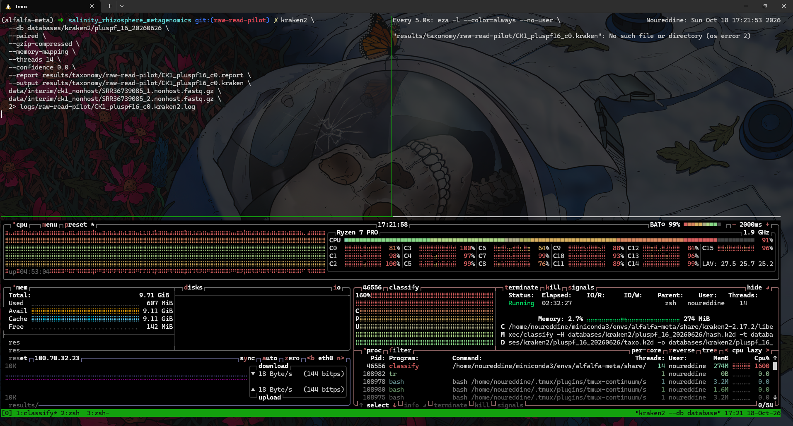
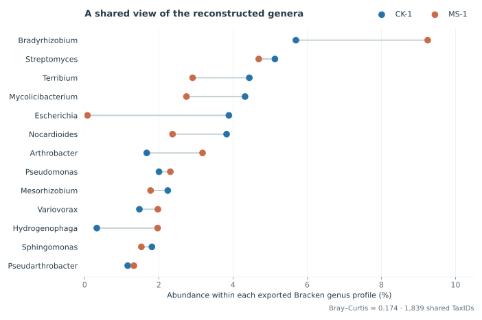
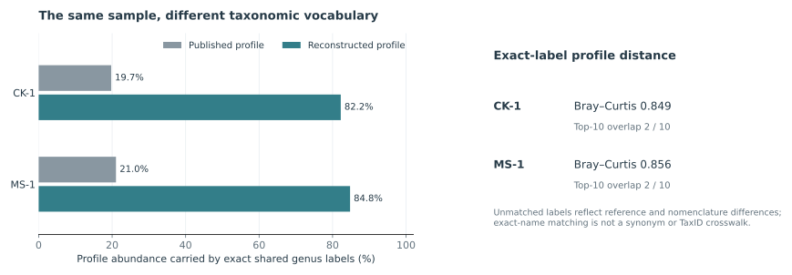
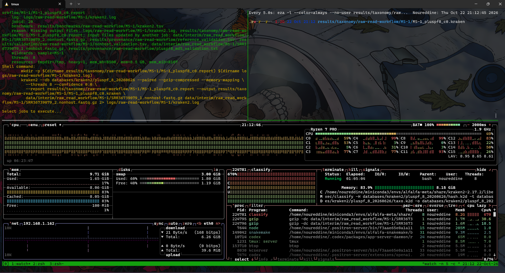
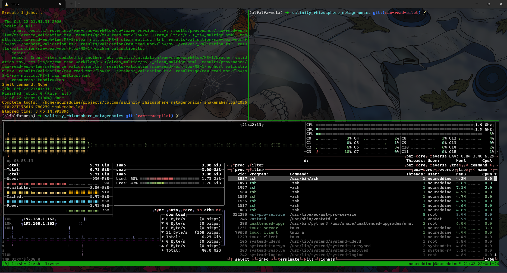

<style>
:root {
  --ck: #0072B2;
  --ms: #C96A48;
  --teal: #00897b;
  --amber: #d98c00;
  --ink: #263238;
  --muted: #5f6b72;
  --line: #dfe5e8;
  --panel: #f7f9fa;
  --soft-blue: #eef6fb;
}
body { color: var(--ink); font-family: Inter, ui-sans-serif, system-ui, -apple-system, BlinkMacSystemFont, "Segoe UI", sans-serif; }
h1, h2, h3 { letter-spacing: -0.015em; }
h2 { border-bottom: 1px solid var(--line); padding-bottom: .35rem; }
.scope-key { display: flex; flex-wrap: wrap; gap: .55rem; margin: 1rem 0 1.4rem; }
.scope-key span { color: white; font-weight: 650; padding: .3rem .7rem; border-radius: 999px; }
.ck { background: var(--ck); } .ms { background: var(--ms); } .method { background: #526f7c; }
.metric-grid { display: grid; grid-template-columns: repeat(auto-fit, minmax(155px, 1fr)); gap: .8rem; margin: 1.1rem 0 1.5rem; }
.metric { border: 1px solid var(--line); border-top: 4px solid var(--ck); border-radius: .35rem; padding: .85rem 1rem; background: white; }
.metric:nth-child(2) { border-top-color: var(--teal); }
.metric:nth-child(3) { border-top-color: var(--amber); }
.metric:nth-child(4) { border-top-color: #607d8b; }
.metric strong { display: block; font-size: 1.42rem; line-height: 1.2; color: #17324d; }
.metric span { display: block; color: var(--muted); font-size: .88rem; margin-top: .25rem; }
.workflow { display: flex; flex-wrap: wrap; align-items: center; gap: .45rem; margin: 1.2rem 0 1.6rem; }
.workflow .step { background: white; border: 1px solid var(--line); border-radius: .38rem; padding: .48rem .68rem; font-size: .88rem; font-weight: 620; }
.workflow .arrow { color: #78909c; font-weight: 700; }
.small-note { color: var(--muted); font-size: .92rem; }
details { border: 1px solid var(--line); border-radius: .4rem; background: #fbfcfc; margin: .8rem 0; padding: .15rem .8rem .55rem; }
summary { cursor: pointer; color: #294a60; font-weight: 680; padding: .65rem 0 .25rem; }
figure { margin-top: 1.4rem; margin-bottom: 1.7rem; }
figcaption { color: var(--muted); font-size: .92rem; }
.execution-figure { max-width: 860px; margin: 1.15rem auto 1.8rem; }
.execution-frame { overflow: hidden; border: 1px solid var(--line); border-radius: .4rem; background: #101214; }
.execution-frame img { display: block; max-width: none; height: auto; }
.execution-figure.running .execution-frame { aspect-ratio: 1.48; }
.execution-figure.running img { width: 126%; }
.execution-figure.complete { max-width: 800px; }
.execution-figure.complete .execution-frame { aspect-ratio: 2.07; }
.execution-figure.complete img { width: 202%; }
.execution-figure figcaption { margin-top: .55rem; line-height: 1.45; }
table { font-size: .93rem; }
@media (max-width: 850px) {
  .workflow .arrow { display: none; }
}
</style>

<div class="scope-key">
  <span class="ck">CK-1 · SRR36739085</span>
  <span class="ms">MS-1 · SRR36739079</span>
  <span class="method">raw reads → genus profile</span>
</div>

## Project overview

Lv et al. (2026) investigated how salinity relates to the alfalfa root-zone microbiome. Here, two deposited metagenomes are independently reconstructed from raw reads: control sample CK-1 and moderate-salinity sample MS-1. Their reads pass through the same quality-control, host-depletion and taxonomic workflow, allowing a descriptive comparison of the recovered communities and a direct check against each sample’s published genus profile.

The analysis asks what is reproducible from the public reads and where taxonomic reference choice, nomenclature and reporting detail affect the answer.

<div class="metric-grid">
  <div class="metric"><strong>68.78 M</strong><span>raw pairs across both runs</span></div>
  <div class="metric"><strong>98.5–98.7%</strong><span>cleaned pairs retained after host depletion</span></div>
  <div class="metric"><strong>5.17–5.42%</strong><span>non-host fragments classified</span></div>
  <div class="metric"><strong>0.174</strong><span>CK-1/MS-1 genus Bray–Curtis</span></div>
</div>

::: {.callout-note title="Scope"}
These are **one biological sample from each of two treatments**. The comparison is descriptive: it cannot estimate within-treatment variability or establish a salinity effect. The companion [nine-sample ecological reanalysis](alfalfa_salinity_metagenome_reanalysis.html) uses the published supplementary matrices.
:::

The source runs are [SRR36739085](https://www.ncbi.nlm.nih.gov/sra/SRR36739085) and [SRR36739079](https://www.ncbi.nlm.nih.gov/sra/SRR36739079), within BioProject [PRJNA1399466](https://www.ncbi.nlm.nih.gov/bioproject/PRJNA1399466); the source article is Lv et al. (2026), [DOI 10.3389/fpls.2026.1753229](https://doi.org/10.3389/fpls.2026.1753229).

## Analytical workflow

<div class="workflow">
  <span class="step">SRA archive</span><span class="arrow">→</span>
  <span class="step">paired FASTQ</span><span class="arrow">→</span>
  <span class="step">FastQC / MultiQC</span><span class="arrow">→</span>
  <span class="step">fastp</span><span class="arrow">→</span>
  <span class="step">Bowtie2 host depletion</span><span class="arrow">→</span>
  <span class="step">Kraken2 PlusPF-8</span><span class="arrow">→</span>
  <span class="step">Bracken genus profile</span><span class="arrow">→</span>
  <span class="step">published-profile comparison</span>
</div>

CK-1 was processed manually with recorded commands. MS-1 followed the validated, sample-driven [Snakemake workflow](../workflow/README.md), with `alfalfa-meta` supplying the bioinformatics tools and `alfalfa-snakemake` supplying orchestration and validation. The [scientific workflow diagram](../results/workflow/raw_read_scientific_overview.svg), [CK-1 provenance](../docs/raw_read_provenance.tsv) and [MS-1 validation files](../results/validation/raw-read-workflow/MS-1/) retain detail beyond the narrative below. The R `renv` analysis remains separate.

## SRA acquisition and read integrity

Both complete SRA runs were acquired and converted to paired PE150 FASTQ. SeqKit counts agreed with each run’s SRA size record. The archived runs were not subsampled.

| Sample | Raw read pairs | Raw bases | Final non-host pairs |
|---|---:|---:|---:|
| CK-1 · control | 34,283,431 | 10,285,029,300 | 33,808,912 |
| MS-1 · moderate salinity | 34,492,089 | 10,347,626,700 | 33,983,612 |

For MS-1, a reproducible check of the first 10,000 final paired FASTQ records also found matching mate identifiers and valid sequence/quality lengths. This is a spot-check, not a full-file synchronization proof. The [workflow’s stage checks](../results/validation/raw-read-workflow/MS-1/) additionally verify paired counts and zero discarded singletons.

<details>
<summary>Limited MS-1 mate-identifier check</summary>

```bash
python3 -B scripts/check_fastq_pair_ids.py \
  data/interim/raw_read_workflow/MS-1/SRR36739079_1.nonhost.fastq.gz \
  data/interim/raw_read_workflow/MS-1/SRR36739079_2.nonhost.fastq.gz \
  --pairs 10000
```

Result: `PASS: first 10,000 paired FASTQ records have matching IDs and valid record structure`.

</details>

<details>
<summary>SRA retrieval, conversion and validation commands</summary>

```bash
prefetch SRR36739085 --max-size 10G

fasterq-dump SRR36739085/SRR36739085.sra \
  --split-files \
  --skip-technical \
  -O data/raw/ck1_full \
  -t tmp/sra \
  --size-check only \
  -x

fasterq-dump SRR36739085/SRR36739085.sra \
  --split-files \
  --skip-technical \
  -O data/raw/ck1_full \
  -t tmp/sra \
  -e 8 \
  -p \
  -v

seqkit stats data/raw/ck1_full/SRR36739085_*.fastq
```
</details>

## Raw-read quality

FastQC 0.13.0 and MultiQC 1.35 showed strong raw-read quality in both runs. Adapter signals were negligible, duplication was low, N content passed, and base-quality profiles were strong. Both samples triggered FastQC’s **Per Sequence GC Content** warning/failure.

That warning was not treated as an automatic filtering target. A root-zone shotgun library combines DNA from many genomes with different GC compositions; deviation from FastQC's expected unimodal distribution can therefore be biologically plausible. GC-based removal would risk selecting against real community members.

The raw libraries were already clean enough that preprocessing changed their overall character very little. CK-1’s overall Q30 was 91.98% before and 91.99% after fastp; MS-1’s was 92.60% before and 92.61% after. The remaining GC signal was interpreted in a metagenomic context, not used to select reads for removal.

<details>
<summary>Raw FastQC and MultiQC commands</summary>

```bash
fastqc \
  -t 2 \
  --outdir results/qc/raw-read-pilot/work/raw \
  data/raw/ck1_full/SRR36739085_1.fastq \
  data/raw/ck1_full/SRR36739085_2.fastq

multiqc \
  results/qc/raw-read-pilot/work/raw \
  -o results/qc/raw-read-pilot/raw_multiqc \
  -n CK1_raw_multiqc.html
```
</details>

## Conservative paired-end preprocessing

fastp 1.4.0 processed mates jointly with the recorded defaults. It retained **34,271,117 CK-1 pairs (99.9641%)** and **34,479,851 MS-1 pairs (99.9645%)**. Adapter trimming and low-quality filtering made only small changes. Post-filter FastQC and MultiQC confirmed the high-quality profiles; SeqKit measured 31–150-bp reads after trimming. The practical conclusion for both runs is that conservative preprocessing preserved nearly all paired fragments.

<details>
<summary>fastp and post-filter QC commands</summary>

```bash
fastp \
  --in1 data/raw/ck1_full/SRR36739085_1.fastq \
  --in2 data/raw/ck1_full/SRR36739085_2.fastq \
  --out1 data/interim/ck1_full/SRR36739085_1.clean.fastq.gz \
  --out2 data/interim/ck1_full/SRR36739085_2.clean.fastq.gz \
  --thread 8 \
  --html results/qc/raw-read-pilot/fastp/CK1_fastp.html \
  --json results/qc/raw-read-pilot/fastp/CK1_fastp.json

fastqc \
  -t 2 \
  --outdir results/qc/raw-read-pilot/work/clean \
  data/interim/ck1_full/SRR36739085_1.clean.fastq.gz \
  data/interim/ck1_full/SRR36739085_2.clean.fastq.gz

conda run -n alfalfa-meta multiqc \
  results/qc/raw-read-pilot/work/clean \
  -o results/qc/raw-read-pilot/clean_multiqc \
  -n CK1_clean_multiqc.html
```
</details>

## Alfalfa host-reference selection

Plant DNA can enter root-zone libraries through fine roots, sloughed cells or other plant material. The burden was expected to be lower than in plant tissue, but it was measured rather than assumed.

Both runs used the same RefSeq *Medicago sativa* assembly, **GCF_051527215.1, Bolivia_mono**, retrieved using NCBI Datasets 18.39.0. Its sequence report confirmed ten assembled molecules: nuclear chromosomes 1–8, mitochondrial chromosome `NC_068105.1`, and plastid chromosome `NC_042841.1`. Because all components were already present, no manual organellar concatenation was required.

| Reference property | Recorded value |
|---|---|
| species | *Medicago sativa* |
| assembly | GCF_051527215.1, Bolivia_mono |
| components | Chr1–Chr8, MT, Pltd |
| operational FASTA | `GCF_051527215.1_Bolivia_mono_genomic.fna` |
| SHA-256 | `44ca7c3e5b7bd6e36637015c5e4500ba925b7f3d2af9699c101ddf1be1c58e52` |

This documented reference improves on a central reproducibility gap in Lv et al. (2026), who report BWA-MEM host removal but do not identify the alfalfa assembly or version.

<details>
<summary>Reference inspection, retrieval and indexing commands</summary>

```bash
datasets summary genome accession GCF_051527215.1 \
  --report sequence \
  --as-json-lines \
| dataformat tsv genome-seq \
  --fields accession,assm-unit-acc,chr-name,sequence-name,role,mol-type,seq-length,refseq-seq-acc,genbank-seq-acc \
  > databases/host/medicago_sativa/GCF_051527215.1_sequence_report.tsv

datasets download genome accession GCF_051527215.1 \
  --include genome,seq-report \
  --filename databases/host/medicago_sativa/GCF_051527215.1.zip

sha256sum \
  databases/host/medicago_sativa/GCF_051527215.1_Bolivia_mono_genomic.fna

bowtie2-build \
  --threads 4 \
  databases/host/medicago_sativa/GCF_051527215.1_Bolivia_mono_genomic.fna \
  databases/host/medicago_sativa/bowtie2/GCF_051527215.1_Bolivia_mono

bowtie2-inspect \
  -s \
  databases/host/medicago_sativa/bowtie2/GCF_051527215.1_Bolivia_mono
```
</details>

## Strict paired-end host depletion

Bowtie2 2.5.5 aligned the cleaned paired reads end-to-end in sensitive mode. The resulting SAM stream was converted directly to BAM by Samtools 1.24, avoiding a large intermediate SAM file.

The depletion rule was intentionally fragment-level: **if either mate mapped to alfalfa, the complete pair was removed**. This preserves synchronization and avoids retaining the unaligned mate of a fragment with host evidence.

Strict filtering removed **462,205 CK-1 pairs (1.3487% of cleaned pairs)** and **496,239 MS-1 pairs (1.4392%)**. In MS-1, 438,249 pairs had both mates mapped, 41,659 had only R1 mapped and 16,331 had only R2 mapped; together these equal the removed total. The four exclusive categories, including 33,983,612 both-unmapped pairs, sum exactly to its 34,479,851 cleaned pairs. The corresponding CK-1 categories also reconcile. MAPQ checks were diagnostic, not a substitute for the fragment-level rule: low-quality host alignments can arise from repetitive sequence. No singletons were discarded during either extraction.

{fig-alt="Paired stacked read-fate bars for CK-1 and MS-1, alongside an enlarged comparison of Kraken2 classification fractions." width=100%}

Host-associated DNA was detectable but modest in these operationally defined root-zone samples. The figure also exposes the much larger taxonomic uncertainty: most retained non-host fragments were not classified by this particular reference database.

<details>
<summary>Host alignment, strict extraction and validation commands</summary>

```bash
bowtie2 \
  --end-to-end \
  --sensitive \
  -x databases/host/medicago_sativa/bowtie2/GCF_051527215.1_Bolivia_mono \
  -1 data/interim/ck1_full/SRR36739085_1.clean.fastq.gz \
  -2 data/interim/ck1_full/SRR36739085_2.clean.fastq.gz \
  -p 8 \
  --met-stderr \
  --met 30 \
  --time \
  2> results/host_depletion/raw-read-pilot/CK1_bowtie2_host.log \
| samtools view \
    -b \
    -o data/interim/ck1_host/CK1_vs_alfalfa.bam \
    -

samtools quickcheck -v data/interim/ck1_host/CK1_vs_alfalfa.bam

samtools view \
  -u \
  -f UNMAP,MUNMAP \
  -F SECONDARY,SUPPLEMENTARY \
  data/interim/ck1_host/CK1_vs_alfalfa.bam \
| samtools collate \
    -@ 12 \
    -u \
    -O \
    - \
| samtools fastq \
    -@ 12 \
    -1 data/interim/ck1_nonhost/SRR36739085_1.nonhost.fastq.gz \
    -2 data/interim/ck1_nonhost/SRR36739085_2.nonhost.fastq.gz \
    -0 /dev/null \
    -s /dev/null \
    -n \
    -

conda run -n alfalfa-meta seqkit stats \
  data/interim/ck1_nonhost/SRR36739085_1.nonhost.fastq.gz \
  data/interim/ck1_nonhost/SRR36739085_2.nonhost.fastq.gz
```
</details>

<details>
<summary>Pair-category counts and MAPQ sensitivity commands</summary>

```bash
samtools view -c --threads 12 \
  -f READ1 \
  -F SECONDARY,SUPPLEMENTARY \
  data/interim/ck1_host/CK1_vs_alfalfa.bam

samtools view -c --threads 12 \
  -f READ1,UNMAP,MUNMAP \
  -F SECONDARY,SUPPLEMENTARY \
  data/interim/ck1_host/CK1_vs_alfalfa.bam

samtools view -c --threads 12 \
  -f READ1,MUNMAP \
  -F UNMAP,SECONDARY,SUPPLEMENTARY \
  data/interim/ck1_host/CK1_vs_alfalfa.bam

samtools view -c --threads 12 \
  -f READ1,UNMAP \
  -F MUNMAP,SECONDARY,SUPPLEMENTARY \
  data/interim/ck1_host/CK1_vs_alfalfa.bam

samtools view -c --threads 12 \
  -f READ1 \
  -F UNMAP,MUNMAP,SECONDARY,SUPPLEMENTARY \
  data/interim/ck1_host/CK1_vs_alfalfa.bam

samtools view -c --threads 12 -q 20 \
  -f READ1,MUNMAP \
  -F UNMAP,SECONDARY,SUPPLEMENTARY \
  data/interim/ck1_host/CK1_vs_alfalfa.bam

samtools view -c --threads 12 -q 30 \
  -f READ1,MUNMAP \
  -F UNMAP,SECONDARY,SUPPLEMENTARY \
  data/interim/ck1_host/CK1_vs_alfalfa.bam

samtools view -c --threads 12 -q 20 \
  -f READ2,MUNMAP \
  -F UNMAP,SECONDARY,SUPPLEMENTARY \
  data/interim/ck1_host/CK1_vs_alfalfa.bam

samtools view -c --threads 12 -q 30 \
  -f READ2,MUNMAP \
  -F UNMAP,SECONDARY,SUPPLEMENTARY \
  data/interim/ck1_host/CK1_vs_alfalfa.bam
```
</details>

## Taxonomic database choice

The primary classifier was Kraken2 2.17.2, followed by Bracken genus-level abundance re-estimation. The selected database was **PlusPF-8, release 26 June 2026**, which combines the Standard collection with fungi and protozoa. This broader scope is appropriate for untargeted root-zone DNA, while PlusPFP was not used because explicit alfalfa depletion had already been completed against a verified nuclear-plus-organellar host reference.

The “8” denotes a size-capped database, not a database containing only a few selected organisms. The broad reference collections remain represented, but minimizer downsampling reduces reference density to fit an approximately 7.5–8 GB index. This makes local classification feasible at the cost of some sensitivity and discrimination.

Both the PlusPF-8 archive and extracted files passed the official MD5 manifest. The database's packaged 150-bp Bracken distribution matched the read model used below.

### PlusPF-16 feasibility attempt

WSL memory was increased to 10 GB to support taxonomy. A larger PlusPF-16 database was downloaded and also passed its official MD5 manifest. Classification was attempted with 14 threads and memory mapping, but was manually interrupted after approximately 2 h 32 min because the workstation-scale resource demand was impractical. No usable PlusPF-16 classification result was produced, so this attempt informs computational feasibility only; it is not a database comparison and not a software crash.

{fig-alt="Resource-monitor screenshot from the running PlusPF-16 feasibility attempt." width=95%}

<details>
<summary>Database download, verification and PlusPF-8 classification commands</summary>

```bash
curl -fL --retry 5 --retry-delay 5 -C - \
  https://genome-idx.s3.amazonaws.com/kraken/k2_pluspf_08_GB_20260626.tar.gz \
  -o databases/kraken2/pluspf_8_20260626/k2_pluspf_08_GB_20260626.tar.gz

tar -xzf \
  databases/kraken2/pluspf_8_20260626/k2_pluspf_08_GB_20260626.tar.gz \
  -C databases/kraken2/pluspf_8_20260626/

(
  cd databases/kraken2/pluspf_8_20260626
  md5sum -c metadata/pluspf_08_GB.md5
)

kraken2 \
  --db databases/kraken2/pluspf_8_20260626 \
  --paired \
  --gzip-compressed \
  --memory-mapping \
  --threads 8 \
  --confidence 0.0 \
  --report results/taxonomy/raw-read-pilot/CK1_pluspf8_c0.report \
  --output results/taxonomy/raw-read-pilot/CK1_pluspf8_c0.kraken \
  data/interim/ck1_nonhost/SRR36739085_1.nonhost.fastq.gz \
  data/interim/ck1_nonhost/SRR36739085_2.nonhost.fastq.gz \
  2> logs/raw-read-pilot/CK1_pluspf8_c0.kraken2.log

# PlusPF-16 feasibility attempt; manually interrupted without a usable result
kraken2 \
  --db databases/kraken2/pluspf_16_20260626 \
  --paired \
  --gzip-compressed \
  --memory-mapping \
  --threads 14 \
  --confidence 0.0 \
  --report results/taxonomy/raw-read-pilot/CK1_pluspf16_c0.report \
  --output results/taxonomy/raw-read-pilot/CK1_pluspf16_c0.kraken \
  data/interim/ck1_nonhost/SRR36739085_1.nonhost.fastq.gz \
  data/interim/ck1_nonhost/SRR36739085_2.nonhost.fastq.gz \
  2> logs/raw-read-pilot/CK1_pluspf16_c0.kraken2.log
```
</details>

## Kraken2 classification and Bracken estimation

Kraken2 used paired-fragment classification, eight threads, memory mapping and confidence 0.0 for both samples. It classified **1,833,747 / 33,808,912 CK-1 fragments (5.42%)** and **1,756,206 / 33,983,612 MS-1 fragments (5.17%)**. The unclassified fractions—94.58% and 94.83%, respectively—are substantial. They need not indicate poor sequencing or biological novelty: environmental reference coverage, sequence divergence, limited read-level signal and minimizer downsampling can all affect assignment. Their relative contributions cannot be resolved here.

Bracken re-estimated genus abundances with the database’s 150-bp model and a threshold of 10. The exported tables contain **1,897 CK-1** and **1,974 MS-1** genus rows. These are thresholded estimates, not measurements of absolute organism counts or directly comparable richness.

::: {.callout-note title="Two distinct denominators"}
**Kraken2 classification rate:** classified fragments / all final non-host fragments.<br>
**Genus composition in this report:** each exported `new_est_reads` value / the sum of its sample’s exported genus estimates: 1,829,204 for CK-1 and 1,751,429 for MS-1. These denominators are not interchangeable.
:::

MS-1 Bracken’s accounting gives 1,185,005 reads retained directly at genus rank plus 567,408 distributed reads, or 1,752,413 before integer export; 3,534 were excluded below the genus threshold and 259 were not redistributed. Its exported `new_est_reads` sum to 1,751,429—984 fewer. Inspection of the installed Bracken code confirms that it sums fractional estimates but writes each genus estimate as a truncated integer. Row-wise truncation is sufficient to account for a gap of this size across 1,974 genera; the exact unrounded allocations are not retained in the output. There is no discrepancy in the input fragment count. The published `fraction_total_reads` values are rounded separately, so this report consistently recomputes within-profile percentages from exported counts.

The Bioconda environment identifies the installed package as Bracken 3.1, while its bundled executable reports v3.0.1. Both identifiers are retained in the provenance rather than silently selecting one.

<details>
<summary>Bracken command</summary>

```bash
bracken \
  -d databases/kraken2/pluspf_8_20260626 \
  -i results/taxonomy/raw-read-pilot/CK1_pluspf8_c0.report \
  -o results/taxonomy/raw-read-pilot/CK1_pluspf8_c0_genus.bracken \
  -r 150 \
  -l G \
  -t 10 \
  > logs/raw-read-pilot/CK1_pluspf8_c0_bracken_genus.log 2>&1
```
</details>

## Reconstructed communities: a descriptive comparison

The two Bracken profiles were generated with the same database, settings and genus-level denominator. The figure uses one shared set of 13 abundant genera, selected by their combined within-profile proportions, so positions can be compared directly. *Bradyrhizobium* leads both profiles, at **5.70% in CK-1** and **9.25% in MS-1**; *Streptomyces* contributes 5.13% and 4.69%, respectively. Other genera vary in prominence, notably *Arthrobacter*, *Terribium* and *Mycolicibacterium*.

{fig-alt="Paired dot plot of thirteen leading Bracken genera in CK-1 and MS-1, using consistent genus-level relative abundance denominators." width=100%}

Across the union of TaxIDs, Bray–Curtis dissimilarity between the two normalized profiles is **0.174**; 1,839 TaxIDs occur in both thresholded tables. This is a distance between **one control and one moderate-salinity sample**, not evidence that salinity caused any particular taxon to change. Likewise, a genus name such as *Bradyrhizobium* does not establish nodule occupancy or nitrogen fixation.

## Comparison with the released genus profiles

The [canonical sample manifest](../data/metadata/sample_manifest.tsv) links each run to the matching column of the [15,805-row supplementary genus matrix](../data/processed/genus_abundance.tsv). The source’s abundance unit is undocumented, so each published column and each reconstructed Bracken table was normalized to its own genus-level total before comparison. Exact, case-sensitive genus labels were matched; no synonym or TaxID crosswalk was invented.

{fig-alt="Published and reconstructed genus profiles have asymmetric exact-label abundance coverage and high exact-label Bray–Curtis distances in both samples." width=100%}

CK-1 has **1,358** exact shared labels and MS-1 **1,419**. Yet those labels carry only **19.74%** and **21.05%** of the published abundance, versus **82.23%** and **84.77%** of the reconstructed abundance. The same-sample, exact-label Bray–Curtis distances are **0.849** and **0.856**; each top-10 list shares just two names with its counterpart. CK-1’s positive shared genera retain a moderate rank relationship (**Spearman ρ = 0.645**), but that relationship concerns the matched subset, not the entire community.

The contrast is concrete in MS-1: published *Sediminibacterium* contributes approximately **3.57%** of its supplementary profile, while the independent Bracken table assigns it approximately **0.037%**. The published top ranks also contain provisional genome-derived labels such as `SCGC-AG-212-J23` and `Gp6-AA40`. Conversely, the independent profiles emphasize named genera such as *Streptomyces*. Some differences may reflect taxonomic vocabulary and reference coverage; others may reflect genuinely different classification or abundance estimates. The available records do not separate these causes or show that either analysis is incorrect.

The published CK-1/MS-1 normalized genus distance is **0.178**, close to the reconstructed **0.174**. Similar overall distances do not imply agreement on the identities or abundances of the taxa producing them. These are descriptive distances, not a statistical test of treatment.

The original workbook also contains 12 genus-label cells converted to Excel date-formatted values. Their intended text cannot be recovered, but none matches a Bracken genus; alternative ISO-date representations leave the CK-1 comparison statistics unchanged. This is a small additional source-format limitation, not an explanation for the broad mismatch.

<details>
<summary>Comparison command and output package</summary>

```bash
"$(conda info --base)/envs/alfalfa-snakemake/bin/python" \
  analysis/raw_read_comparison/compare_ck1_profiles.py \
  --published data/processed/genus_abundance.tsv \
  --bracken results/taxonomy/raw-read-pilot/CK1_pluspf8_c0_genus.bracken \
  --outdir /tmp/ck1-comparison
```

Run this command from the project root. The [comparison package](../analysis/raw_read_comparison/README.md) contains the validated concordance metrics and tables, with details of the historical workbook-label representation. Actual executed commands remain in the [provenance record](../docs/raw_read_provenance.tsv).
</details>

## Computational reproducibility and interpretation

MS-1 completed **22/22 Snakemake jobs** on 22 October 2026 in **3 h 45 min 15 s**. The local execution log (`.snakemake/log/2026-10-22T175616.780279.snakemake.log`), [validation reports](../results/validation/raw-read-workflow/MS-1/) and [stage benchmarks](../results/benchmarks/raw-read-workflow/MS-1/) document the run. The 22-job count reflects an already-completed software preflight, not a skipped scientific stage. MS-1’s timed Kraken2 rule took **1 h 33 min 36 s**; host alignment took **27 min 8 s**, and host-category counting **32 min 31 s**. Bracken completed in seconds. Benchmark wall times are available, but CPU and memory fields were not collected successfully, so no peak-resource figure is inferred.

<figure class="execution-figure running"><div class="execution-frame"></div><figcaption>Illustrative live monitoring view while MS-1 Kraken2 classification was running. The monitor documents execution context; its instantaneous CPU and memory readings are not formal peak-resource benchmarks.</figcaption></figure>

<figure class="execution-figure complete"><div class="execution-frame"></div><figcaption>Successful completion of the MS-1 workflow: the terminal records 22 of 22 steps completed and an elapsed time of 3 h 45 min 15 s.</figcaption></figure>

<details>
<summary>Executed MS-1 workflow command and validation record</summary>

The recorded Snakemake invocation, from the repository root with `alfalfa-meta` active, was:

```bash
/home/noureddine/miniconda3/envs/alfalfa-snakemake/bin/snakemake \
  --snakefile workflow/Snakefile \
  --profile workflow/profiles/local \
  --config 'active_samples=["MS-1"]'
```

The local profile provided 12 cores, `mem_mb=9000` and `heavy=1` to avoid concurrent heavy jobs. The [technical DAG](../results/workflow/ms1_raw_read_workflow.svg) and [rule graph](../results/workflow/raw_read_rule_graph.svg) are supporting architecture views. MS-1 validation outputs confirm SRA/read agreement, equal mate counts after fastp and extraction, exact host-category summation, Kraken2 input/output reconciliation, nonnegative Bracken estimates and zero discarded singletons.

</details>

The earlier manual CK-1 Kraken2 processing time was about **20 min 46 s**, versus **88 min 30 s** reported internally by Kraken2 for MS-1. The samples had similar numbers of input fragments, but the records do not establish the cause of the longer MS-1 classification. The manually executed CK-1 steps and the full MS-1 workflow are not directly comparable as end-to-end timing experiments.

Three methodological observations shape interpretation. First, the FastQC GC warning was not a reason to discard environmental reads. Second, host depletion can be specified and checked at the paired-fragment level against a versioned, nuclear-plus-organellar reference. Third, the reference database and abundance denominator are part of the taxonomic result: Kraken2’s classified fraction, Bracken’s thresholded genus counts and normalized genus composition measure different quantities.

The analytical boundary remains substantial. PlusPF-8 is a workstation-scale, minimizer-downsampled database; reference coverage and the original study’s unspecified database build, classifier settings and abundance unit limit exact profile replication. The attempted PlusPF-16 run was interrupted for feasibility reasons and produced no comparative classification. A confidence-0.1 sensitivity analysis was not performed. Equal paired-read counts and the 10,000-pair MS-1 identifier check support synchronization but do not replace a full-file identifier audit. Above all, CK-1 and MS-1 provide no replication within treatment and cannot support a salinity-effect test.

## Methodological guidance and references

The preprocessing logic follows the four-stage framework of raw-read assessment, adapter/quality processing, host depletion and final clean-read evaluation described by Li et al. (2026). Tool interpretation was also guided by official version-specific documentation rather than treating default warnings as biological conclusions.

- Bo Li et al. (2026), “Metagenomic Data Preprocessing and Quality Control,” in *Microbial ‘Omics: Methods and Protocols*, pp. 43–61. [DOI 10.1007/978-1-0716-5264-0_3](https://doi.org/10.1007/978-1-0716-5264-0_3).
- Shifu Chen et al. (2018), “fastp: an ultra-fast all-in-one FASTQ preprocessor.” *Bioinformatics* 34: i884–i890. [DOI 10.1093/bioinformatics/bty560](https://doi.org/10.1093/bioinformatics/bty560).
- Philip Ewels et al. (2016), “MultiQC: summarize analysis results for multiple tools and samples in a single report.” *Bioinformatics* 32: 3047–3048. [DOI 10.1093/bioinformatics/btw354](https://doi.org/10.1093/bioinformatics/btw354).
- Ben Langmead and Steven L. Salzberg (2012), “Fast gapped-read alignment with Bowtie 2.” *Nature Methods* 9: 357–359. [DOI 10.1038/nmeth.1923](https://doi.org/10.1038/nmeth.1923).
- Bede Constantinides, Martin Hunt and Derrick W. Crook (2023), “Hostile: accurate decontamination of microbial host sequences.” *Bioinformatics* 39: btad728. [DOI 10.1093/bioinformatics/btad728](https://doi.org/10.1093/bioinformatics/btad728).
- Derrick E. Wood, Jennifer Lu and Ben Langmead (2019), “Improved metagenomic analysis with Kraken 2.” *Genome Biology* 20: 257. [DOI 10.1186/s13059-019-1891-0](https://doi.org/10.1186/s13059-019-1891-0).
- Jennifer Lu et al. (2017), “Bracken: estimating species abundance in metagenomics data.” *PeerJ Computer Science* 3: e104. [DOI 10.7717/peerj-cs.104](https://doi.org/10.7717/peerj-cs.104).
- Jennifer Lu et al. (2022), “Metagenome analysis using the Kraken software suite.” *Nature Protocols* 17: 2815–2839. [DOI 10.1038/s41596-022-00738-y](https://doi.org/10.1038/s41596-022-00738-y). Its 2024 [Author Correction](https://doi.org/10.1038/s41596-024-01064-1) added omitted paired-read guidance, reinforcing the need to report `--paired` explicitly.

## Conclusion

Both public runs yielded complete, validated paired-read reconstructions. Conservative preprocessing preserved virtually all fragments; strict alfalfa depletion removed about 1.3–1.4% of cleaned pairs. The common PlusPF-8 workflow recovered genus profiles with a CK-1/MS-1 Bray–Curtis dissimilarity of **0.174**.

The larger finding is methodological. Only about 5% of final non-host fragments were classified, and each reconstructed profile differs substantially from its corresponding published genus profile under exact-label comparison. These differences do not invalidate either result. They show why versioned references, explicit denominators, taxonomic crosswalks and transparent execution records matter when interpreting environmental metagenomes.

---

<span class="small-note">[Project homepage](https://noureddineidali.github.io/alfalfa-salinity-metagenomics/) · Supporting record: [raw-read provenance](../docs/raw_read_provenance.tsv) · [Snakemake workflow](../workflow/README.md) · [MS-1 validation](../results/validation/raw-read-workflow/MS-1/) · [dataset reconnaissance](../docs/dataset_reconnaissance.md) · [taxonomic comparison package](../analysis/raw_read_comparison/README.md)</span>
