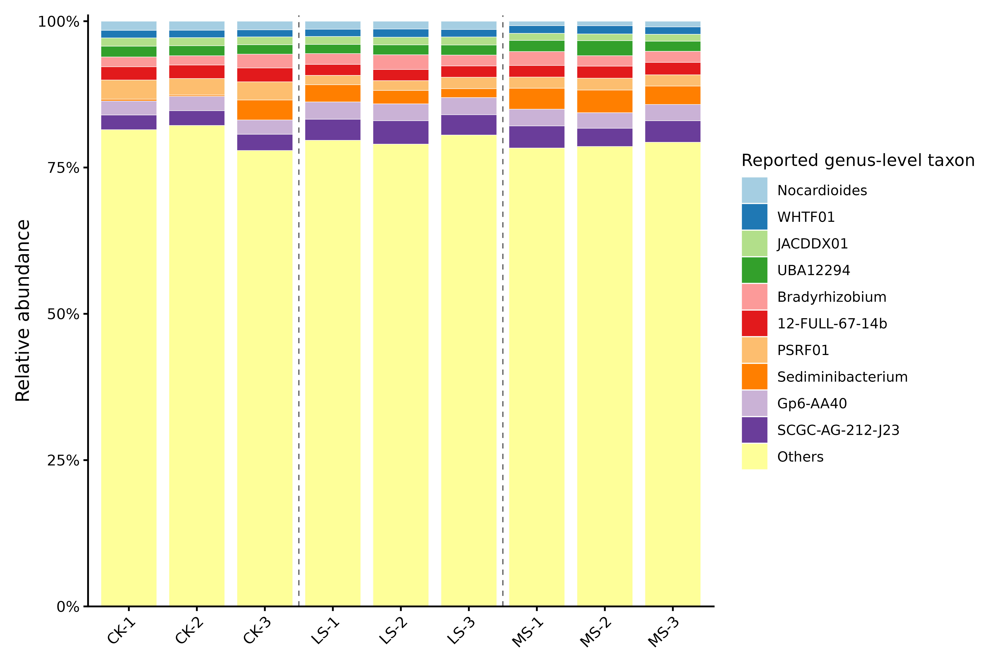
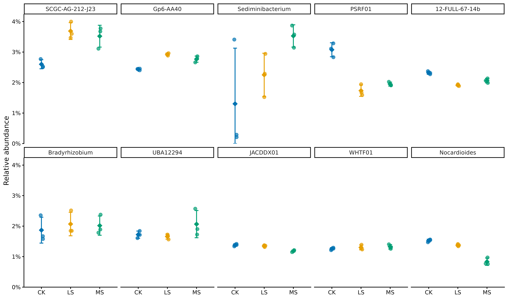
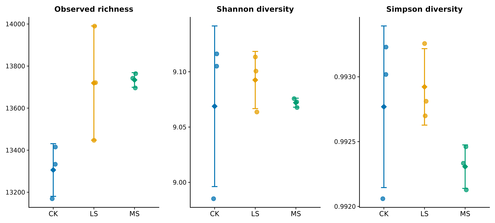
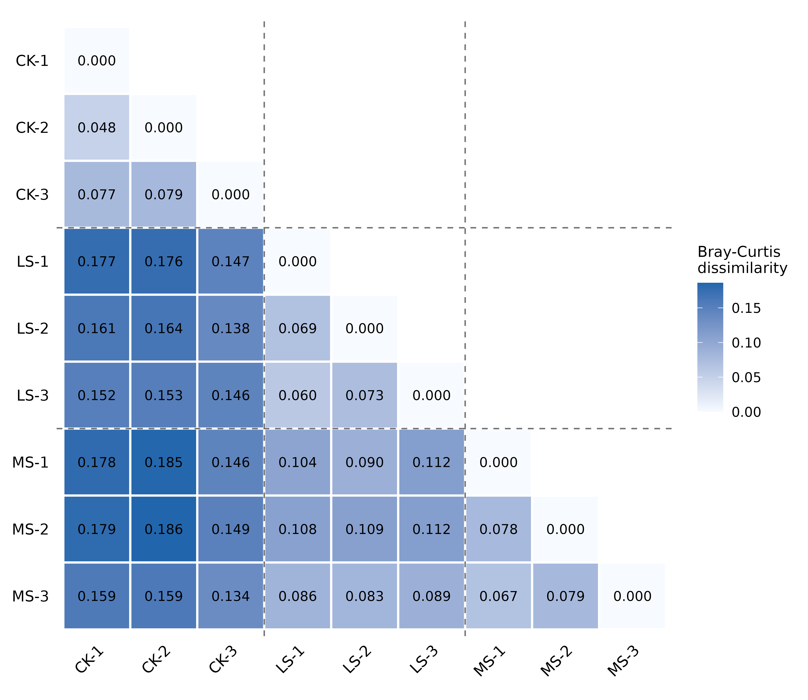
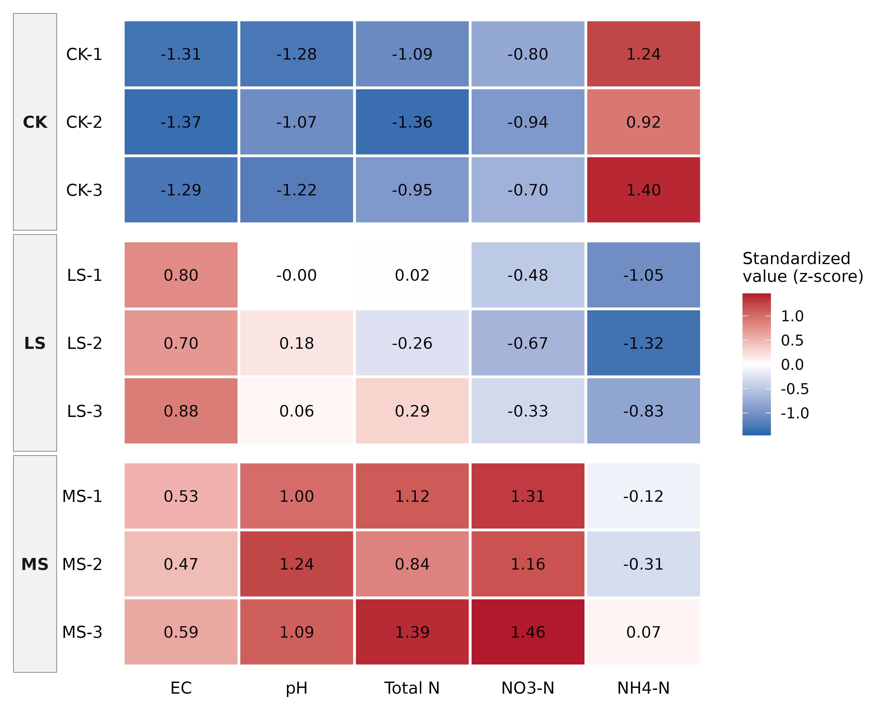

  CK · control
  LS · low salinity
  MS · moderate salinity

## Project overview

Lv et al. (2026) investigated how increasing salinity reshaped the alfalfa root-zone microbiome and its metagenome-inferred functional potential. Here, the released sample-level data were reconstructed and independently reanalyzed to quantify community restructuring, investigate sample-level heterogeneity, and test the robustness and reproducibility of the reported functional patterns.

The analysis connects genus-level composition, within- and between-sample diversity, measured soil conditions, and selected KEGG pathway profiles. Particular attention is given to effects that become visible only at the multivariate or sample-resolved level, and to whether functional conclusions remain stable under alternative representations of the same released data.

Key analytical results

  
<strong>R² = 0.775</strong>taxonomic treatment effect

  
<strong>r = −0.9988</strong>raw functional PCoA1 vs pathway total

  
<strong>R² = 0.822</strong>normalized functional treatment effect

The source study is [BioProject PRJNA1399466](https://www.ncbi.nlm.nih.gov/bioproject/PRJNA1399466), linked to Lv et al. (2026), [DOI 10.3389/fpls.2026.1753229](https://doi.org/10.3389/fpls.2026.1753229). The full accession-level record and data-volume audit are documented in the [dataset reconnaissance](../docs/dataset_reconnaissance.md).

## Study design and public dataset

Alfalfa (*Medicago sativa* L. ‘Algonquin’) was grown in a 105-day pot experiment using chestnut soil. Each pot contained 7.5 kg soil and 20 seedlings. CK received no added salt; LS received 3.0 g kg⁻¹ dry soil; and MS received 4.5 g kg⁻¹. The salt mixture was NaCl and Na₂SO₄ in a 1:1 mass ratio.

| Treatment | Applied salt | Samples | Interpretation |
|---|---:|---|---|
| CK | 0 g kg⁻¹ | CK-1, CK-2, CK-3 | non-saline control |
| LS | 3.0 g kg⁻¹ | LS-1, LS-2, LS-3 | low salinity, reported as 0.3% |
| MS | 4.5 g kg⁻¹ | MS-1, MS-2, MS-3 | moderate salinity, reported as 0.45% |

The publication's experimental schematic shows eight pots per treatment, but only three samples per treatment were sequenced. It does not report how these three were selected, their pot identifiers, or whether the sequenced soil and plant measurements can be linked to the same named pots. The pot—not each of the 20 plants within a pot—is the independent experimental unit.

Sequencing used the Illumina NovaSeq 6000 with paired 150-bp reads. Across nine runs, NCBI reports 335,932,964 SRA spots/read pairs, approximately 671,865,928 individual reads, and 100.78 Gb of sequence. The sampled material was obtained by coring soil near visible roots and is best described as **operationally defined root-zone soil**, not a strictly isolated rhizosphere fraction.

## Data reconstruction and reproducibility audit

The supplementary files were heterogeneous: conventional workbooks, CSV files, a tab-delimited text file carrying an `.xls` extension, and a methodological Word document. Reconstruction produced four analysis-ready inputs without changing original numerical values. This report analyzes those released processed matrices; independent raw-read/SRA reprocessing remains a later phase.

| Reconstructed input | Dimensions | Main validation |
|---|---:|---|
| sample manifest | 9 samples | treatment, replicate, BioSample, SRA sample, experiment, and run accessions |
| environmental/plant metadata | 9 × 11 | eight reported variables plus sample, treatment, and replicate fields |
| genus abundance matrix | 15,805 × 9 | numbered columns mapped to CK-1…MS-3 using all labelled dominant genera |
| pathway abundance matrix | 30 × 9 | names, row order, and all 270 numerical values preserved |

The genus values were left in their undocumented supplementary abundance unit. They were converted to within-sample proportions only inside analyses that required composition. The pathway unit is also not defined by the source. This prevents interpretation as absolute gene, cell, or pathway-copy abundance.

The audit also retained source inconsistencies rather than silently repairing them. These include an MS dry-biomass discrepancy between two supplementary files, an inconsistent CK-3 *Sediminibacterium* value in one workbook, an unnamed diversity metric, and the absence of the gene catalogue and annotation crosswalk needed to reconstruct the nitrogen figure. Full details are in the [supplementary-data audit](../docs/supplementary_data_audit.md) and [processed-data validation](../docs/processed_data_validation.md).

## Taxonomic composition

The full matrix contains many recognizable genus names and many database-derived provisional or coded labels. Labels were preserved as released; coded names were not replaced by speculative taxonomy. For visualization, genera were ranked by mean relative abundance across all nine samples, the ten highest-ranked labels were displayed, and every remaining row was combined as `Others`.

{fig-alt="Stacked relative-abundance bars for CK, LS and MS samples, with most abundance assigned to the combined Others category." width=95%}

The large `Others` fraction shows that the displayed genera are a compact summary of a long, diverse tail rather than a complete description of the community. CK-3 has a visibly elevated *Sediminibacterium* fraction, but this feature alone does not explain its position in whole-community analyses.

{fig-alt="Small-multiple treatment plots for the ten most abundant reported genus-level taxa." width=98%}

## Alpha diversity

Within-sample richness and evenness were summarized using observed richness, Shannon diversity, and the `vegan` Simpson implementation. Shannon values calculated with natural logarithms were also converted to base 2. The base-2 values align with the scale of the paper's displayed Shannon results; using the natural-log default without this conversion does not.

{fig-alt="Three alpha-diversity panels showing substantial overlap among CK, LS and MS." width=98%}

Alpha diversity showed considerable overlap among treatments. This does not conflict with strong beta-diversity separation: communities can retain similar richness and evenness while changing which taxa contribute those abundances. The paper does not clearly identify its Simpson convention; the reanalysis names the calculated variants explicitly in `results/tables/genus_alpha_diversity.tsv`.

## Whole-community restructuring

Bray–Curtis dissimilarity was calculated from within-sample genus proportions, followed by PCoA. The ordination is unsupervised: treatment labels colour the samples after their coordinates have been derived from the genus profiles.

{fig-alt="Bray-Curtis PCoA separating CK from salinity treatments on axis 1 and LS from MS on axis 2." width=86%}

  
<strong>R² = 0.775</strong>global taxonomic PERMANOVA

  
<strong>p = 0.0023</strong>9,999-permutation analysis

  
<strong>p = 0.877</strong>PERMDISP

Treatment accounted for 77.5% of the multivariate variation. The non-significant PERMDISP result provides no evidence that this global result was driven by unequal within-group dispersion. Pairwise effect sizes were **R² ≈ 0.775 for CK–LS**, **R² ≈ 0.772 for CK–MS**, and **R² ≈ 0.491 for LS–MS**. These are large descriptive effects, but pairwise significance is poorly resolved: with three samples in each of two groups, only 20 unique group allocations exist.

The reconstructed PCoA explains 64.8% and 16.1% on its first two axes. The publication reports 73.24% and 11.22%. Because the paper does not specify the exact input table, filtering, transformation, ordination implementation, or negative-eigenvalue handling, its percentages were not reproduced exactly.

{fig-alt="Nine by nine Bray-Curtis dissimilarity heatmap for CK, LS and MS samples." width=78%}

## CK-3 sample-level diagnostic analysis

CK-3 is displaced from CK-1 and CK-2 in the PCoA and differs in several dominant-genus abundances. The full Bray–Curtis matrix shows that this is a **whole-community displacement**, not merely the consequence of one conspicuous genus. Removing that distinction would risk mistaking a broad sample profile for a single-feature anomaly.

The measured soil variables do not supply a corresponding explanation. CK-3 remains within the control pattern for EC, pH, total N, nitrate N, and ammonium N; it is not an environmental outlier among the three controls. Unmeasured pot history, sample handling, extraction effects, or genuine biological heterogeneity remain possible, but the released data cannot distinguish them. CK-3 was therefore retained rather than excluded post hoc.

## Environmental context

Soil EC, pH, total N, nitrate N, and ammonium N were standardized across the nine samples for comparison. The expected treatment gradient is visible: CK has lower EC, pH, total N, and nitrate, while ammonium is higher; MS has the strongest pH, total-N, and nitrate pattern.

{fig-alt="Heatmap of standardized EC, pH, total N, nitrate N and ammonium N across nine samples." width=86%}

Fitted-variable analyses associate these measurements strongly with the taxonomic ordination, but treatment and environment are deliberately coupled in this experiment. With nine observations, these associations should be read as environmental context rather than independent causal partitioning. In particular, they do not identify a measured variable that uniquely explains CK-3.

## Functional pathway analysis

The available pathway table contains 30 named KEGG Level 3 summaries, not a complete KO-by-sample or gene-by-sample matrix. Row-wise z-scores can be useful for heatmaps, but they show each pathway relative to its own mean and standard deviation; they do not compare absolute abundance across pathways. Inferential tests therefore used the underlying released values.

Kruskal–Wallis tests identified **13 of 30 pathways with nominal p < 0.05**, including central carbon, amino-acid, energy, and signalling categories. After Benjamini–Hochberg correction, **0 of 30 pathways were significant**. The smallest adjusted p-value was approximately 0.070. The absence of FDR-supported individual pathways does not exclude coordinated change across the pathway profile. We therefore tested the 30 pathways jointly.

::: {.callout-note title="Interpretation boundary"}
The pathway table describes selected metagenome-derived functional potential. It does not demonstrate transcription, protein production, enzyme activity, or nitrogen-transformation rates. Those levels require metatranscriptomic, metaproteomic, enzyme, isotope, or direct process-rate evidence.
:::

## Functional-profile multivariate extension

Treating the 30 released pathways as a multivariate profile revealed strong treatment structure in the raw values:

  
<strong>R² = 0.891</strong>raw functional PERMANOVA

  
<strong>p = 0.0023</strong>treatment permutation test

  
<strong>p = 0.801</strong>raw-profile PERMDISP

  
<strong>88.2% + 8.7%</strong>raw PCoA axes 1 and 2

The dispersion test does not indicate that the raw-profile result is explained by heterogeneous spread. However, the dominance of the first axis required a scale diagnostic before interpreting it as pathway-compositional turnover.

## Pathway-total sensitivity analysis

Raw functional PCoA1 was almost perfectly correlated with each sample's total abundance across the 30 selected pathways: **r = −0.9988**. Bray–Curtis is sensitive to total scale when profiles do not have equal sums, so the raw ordination principally captures differences in the total reported pathway signal.

To separate this scale component from relative profile composition, each sample was normalized to sum to one across the same 30 pathways. The sensitivity analysis does not redefine the unknown source unit; it asks whether treatment structure remains after removing among-sample total differences.

{fig-alt="Composition-normalized functional PCoA separating CK, LS and MS samples." width=86%}

  
<strong>R² = 0.822</strong>composition-normalized PERMANOVA

  
<strong>p = 0.0023</strong>treatment permutation test

  
<strong>p = 0.649</strong>composition-normalized PERMDISP

  
<strong>68.0% + 21.4%</strong>normalized PCoA axes 1 and 2

Treatment structure therefore remains strong after removing the total-abundance scale effect. The two analyses together indicate that the raw pattern contained both an overall abundance-scale component and genuine restructuring in the **relative composition of the 30 selected pathway summaries**.

## Nitrogen-function reproducibility audit

The paper presents Figure 7 as nitrogen-cycling-related functional information, but supplementary `table 6.xlsx` supplies 100 abundance rows identified only by `DBid`. Conservative identifier resolution recovered only part of the missing annotation.

| Audit outcome | Count |
|---|---:|
| DBids examined | 100 |
| reliably resolved full identifiers | 24 |
| unresolved full identifiers | 76 |
| clearly nitrogen-related annotations | 18 |
| direct KO mappings | 0 |
| conservatively assignable to Figure 7 categories | 10 |

Only 24 of 100 identifiers were resolved reliably, none mapped directly to a KO identifier, and 10 could be assigned conservatively to a Figure 7 category. The complete nine-category Figure 7 structure cannot be reconstructed faithfully without the missing gene catalogue, KO assignments, category rules, and identifier crosswalk. Identifier-level evidence is retained in the [nitrogen mapping audit](../docs/nitrogen_mapping_audit.md).

## What the reanalysis added beyond Lv et al. (2026)

  <article class="finding-card">
    
Sample-level discovery

    
CK-3

    
A conspicuous <em>Sediminibacterium</em> pattern led to a broader finding: CK-3 is displaced at the whole-community level, while its measured soil profile remains CK-like.

  </article>
  <article class="finding-card">
    
Community effect quantified

    
R² = 0.775

    
Treatment explained 77.5% of Bray–Curtis variation, while PERMDISP provided no evidence that unequal within-treatment spread accounted for the separation (p = 0.877).

  </article>
  <article class="finding-card">
    
Functional extension

    
r = −0.9988 → R² = 0.822

    
Raw functional PCoA1 largely tracked total selected-pathway abundance. After removing that scale component, strong relative pathway restructuring remained.

  </article>

::: {.secondary-findings}
**Additional reproducibility and statistical findings**

- The reported Shannon scale is consistent with log2 rather than `vegan`'s natural-log default.
- The released genus matrix reproduced the broad PCoA treatment geometry but gave 64.8% and 16.1% for the first two axes, rather than the published 73.24% and 11.22%.
- CK–LS and CK–MS each explained about 77% of two-group variation, although three samples per group permit only 20 unique pairwise label allocations.
- Thirteen of 30 pathways had nominal *p* < 0.05, but none remained significant after BH-FDR correction.
:::

## Limitations and reproducibility lessons

The principal constraint is biological replication: three sequenced samples per treatment provide limited estimates of within-treatment variability and coarse pairwise permutation inference. The unresolved relationship between eight experimental pots and three sequenced samples further limits design interpretation.

This report relies on published processed matrices. It can test internal consistency and ecological statistics, but it cannot independently validate adapter removal, host depletion, taxonomic classification, assembly, gene prediction, quantification, or KEGG annotation. Key missing details include the alfalfa reference accession, trimming thresholds, Kraken2/Bracken versions and parameters, the actual ORF caller, Salmon settings, KEGG release and thresholds, and the annotated non-redundant gene catalogue.

The pathway analysis is limited to 30 selected summaries in an undocumented unit. The functional results concern genomic potential rather than activity. Taxonomic profiles are not automatically linked to functions, and the released files do not identify which organisms carry or express each nitrogen-related gene.

The environmental variables are treatment-responsive and strongly collinear with treatment, so their fitted associations cannot establish independent drivers. The supplementary inconsistencies and incomplete identifier namespaces show why machine-readable sample labels, database versions, crosswalks, and intermediate tables are part of the scientific result rather than optional documentation.

## Conclusions

The released data support strong treatment-associated restructuring of genus-level community composition despite relatively stable alpha diversity. This result is not explained by unequal multivariate dispersion, and its largest pairwise effects involve the control. CK-3 adds an important sample-level dimension: its conspicuous *Sediminibacterium* pattern accompanies a broader whole-community displacement, although its measured soil profile remains CK-like.

The selected functional pathways also show strong treatment-associated compositional restructuring after within-sample normalization. The raw ordination combined this relative restructuring with a dominant total-abundance scale component, as demonstrated by the near-perfect correlation between PCoA1 and pathway total. Individual pathway evidence is weaker: 13 nominal results become zero after BH-FDR correction.

The nitrogen analysis defines a separate reproducibility boundary: the complete Figure 7 categorization cannot be rebuilt from the released identifier information. Claims about nitrogen-process activity, responsible taxa, or pathway flux would additionally require direct linkage and independent activity measurements.

The central result is therefore twofold: salinity is associated with large, reproducible multivariate shifts in the released taxonomic and selected functional profiles, while incomplete annotation and limited replication sharply constrain feature-level and mechanistic conclusions.

---

Analytical record: [dataset reconnaissance](../docs/dataset_reconnaissance.md) · [supplementary-data audit](../docs/supplementary_data_audit.md) · [processed-data validation](../docs/processed_data_validation.md) · [nitrogen mapping audit](../docs/nitrogen_mapping_audit.md)
